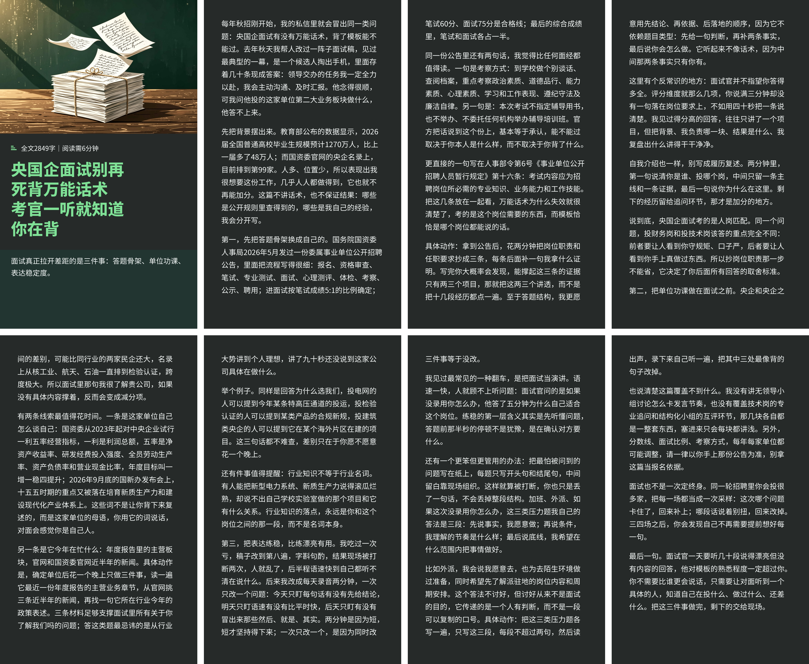
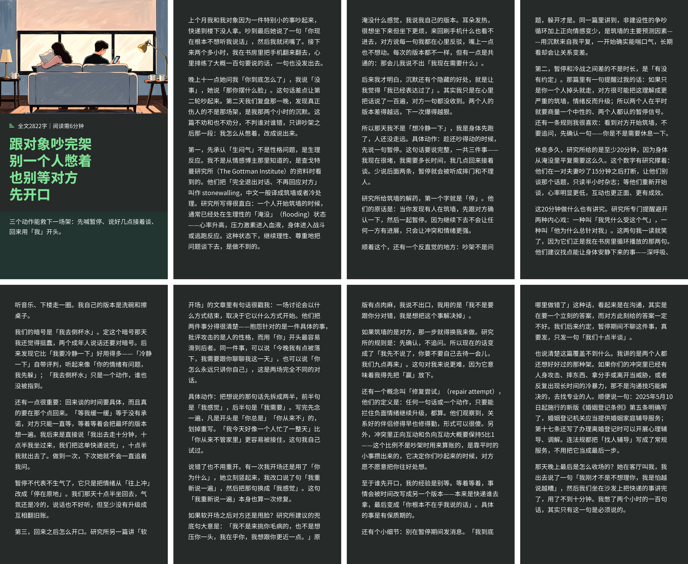
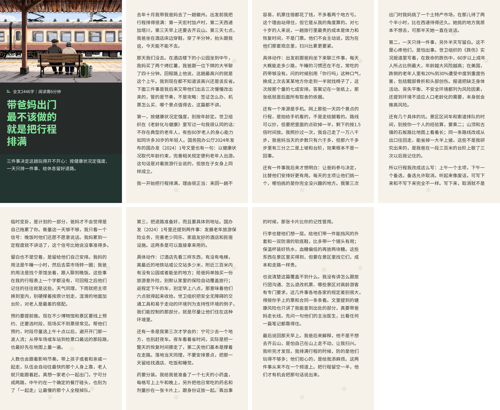

# longform-carousel

把一段真实经历或一篇长文，做成一整套小红书长文图文：**封面 + N 张正文页（1440×2400）**，外加可直接发布的**题目、3 段文案、话题标签、首评**。

A Codex skill that turns one topic into a full RED (Xiaohongshu) long-form carousel: cover + body pages + ready-to-post copy.

## 成品展示

三篇跑出来的完整成品，8 张图横向拼成一张拼版（4 列 × 2 行，页面都是 1440×2400 原始尺寸，点开看原图）：

**求职 · 央国企面试**：2849 字，封面（深色／白底／纸底三版）+ 7 张正文页，深色内页。



**情感 · 跟对象吵完架**：2822 字，封面（深色／纸底两版）+ 7 张正文页，深色内页。



**生活 · 带爸妈出门**：2446 字，封面（深色／纸底两版）+ 6 张正文页，浅色内页。



## 它做什么

- **先查证再写**：每个数字、政策、案例都要能回到出处，写进笔记目录的 `来源.md`；查不到的删掉，不改成模糊说法。
- **没有 AI 腔**：禁用「综上所述」「赋能」「在当今社会」这类词句，每段要有具体的人、时间、数字和动作；自检还会提醒「每段字数几乎一样」这种机器节奏。
- **标题不限领域**：职场面试、读研/考研、租房搬家、旅行、健身、技能、家庭关系都能写。
- **封面图要解题**：遮住标题、只看图能猜到讲什么才算合主题。
- **交付即发布件**：题目候选、3 段文案、标签、首评一起给，外加一张「所有图摆在一起」的拼版预览。
- **能用你自己的经历**：贴一段口述、日记、聊天记录就能出整套图文——素材是唯一事实来源，只筛选重组，不补你没提过的人和事。

## 目录

```
SKILL.md              技能说明：红线、流程、笔记.json 结构
references/
  写作与查证.md        定题、查证、去 AI 腔、写发布件
  版式规格.md          全部字号、边距、配色的唯一来源
scripts/
  render.py           渲染封面与正文页，输出拼版预览
  check.py            自检：尺寸、墨迹边界、分页、配色、字数、AI 腔、发布件
  package.py          打包成可直接用的交付目录
assets/fonts/         Noto Sans SC / Noto Serif SC（OFL）
assets/banner.png     README 顶部这张横幅
assets/make_banner.py 用任意一套渲染好的页面重新生成横幅
assets/showcase/      「成品展示」里那三张成品拼版
examples/带爸妈出门/   一份可以直接跑的示例（素材 + 笔记.json + 插画 + 来源）
```

## 配置

技能就是一个文件夹。**放进 Codex 的 skills 目录，再新开一个会话，就能用 `$longform-carousel` 调用。**

### 1. 放进 skills 目录

macOS / Linux：

```bash
git clone https://github.com/a5577/longform-carousel.git ~/.codex/skills/longform-carousel
```

Windows（PowerShell）：

```powershell
git clone https://github.com/a5577/longform-carousel.git "$env:USERPROFILE\.codex\skills\longform-carousel"
```

不用 git 也可以：下载仓库 ZIP 解压到同一位置。

四个要点：

- `SKILL.md` 必须在技能目录**根部**，别多套一层（不能是 `skills/longform-carousel/longform-carousel/SKILL.md`）。
- 目录名就是调用名：目录叫 `longform-carousel`，就用 `$longform-carousel` 调它；目录名和 `SKILL.md` 里的 `name:` 保持一致。
- 如果你设过 `CODEX_HOME`，路径是 `$CODEX_HOME/skills/longform-carousel`。
- 有些环境还会扫描 `~/.agents/skills/`。放进第一个位置没生效，就再放一份到那里。

### 2. 装依赖

```bash
python -m pip install -U pillow
```

- Python 3.9 以上（本文档在 Python 3.12 + Pillow 12.3 上验证）。
- **字体不用装**：Noto Sans SC / Noto Serif SC 已随仓库放在 `assets/fonts/`。真缺字体时脚本会直接报错并告诉你该放哪，不要用系统宋体凑合。

### 3. 让它生效

skills 目录在**会话启动时**扫描，装完新开一个会话（或重启应用），输入 `$longform` 看看有没有补全。

### 4. 验证装好了

```bash
python -c "import PIL; print('Pillow', PIL.__version__)"
python scripts/render.py --help
python scripts/check.py --help
```

三条都正常，说明 Python、Pillow、脚本、路径都没问题。

### 5. 跑一遍完整流程

「笔记目录」是你自己的工作目录，里面放一个 `笔记.json`（可选 `cover.png` 封面插画、`来源.md` 出处记录）：

```bash
python scripts/render.py <笔记目录>
python scripts/check.py  <笔记目录>
python scripts/package.py --note <笔记目录> --accept-visual "逐页看过，无压字无空页"
```

把 `<笔记目录>` 换成你自己的路径（尖括号是占位符，别照抄——bash 会把它当成重定向）。

产物：`<笔记目录>/pages/p01.png` 起的所有页面、`全套预览.jpg`（所有图拼成一张）、`交付/`（含 `发布文案.md`）。

`笔记.json` 的字段说明见 [SKILL.md](SKILL.md)。

### 6. 调用它

一句话就够，不用交代格式、字数、配色这些：

```
用 $longform-carousel 做一篇「第一次租房被中介坑」。
```

也可以不写技能名，直接描述任务，它会按 `SKILL.md` 的描述自动触发。想精细控制就在那句话后面加半句，比如「内页用浅色，3000 字左右，封面出深色和纸底两版」。

#### 用自己的经历

有素材就直接贴，不用自己先整理：

```
用 $longform-carousel 把下面这段做成图文：

（口述、日记、聊天记录、语音转写，随便什么格式，原样贴）
```

这种情况它会把素材当**唯一事实来源**：只做筛选和重组，不补你没提过的人、时间、地点和数字；真名、单位、病历、金额默认模糊成「我同事」「一家国企」「XX 医院」。照片也可以一起给，能直接当封面插画用。

原文会被原样存进笔记目录的 `素材.md`，`笔记.json` 里写 `"素材": "素材.md"`；`check.py` 会拿正文里的数字和它对一遍，对不上的会提醒你确认——这是防「编」的那道闸。

### 7. agents/openai.yaml（可选）

`agents/openai.yaml` 里是技能在界面上的显示名、简介和默认提示词。想改名或换默认提示词就改这三个字段；不需要就直接删掉这个文件，技能照常工作。

## 示例

仓库里带了一份能直接跑的示例：`examples/带爸妈出门/`（生活 / 旅行题材，1809 字，5 页正文，封面出深色／纸底／白底三版）。

```bash
python scripts/render.py examples/带爸妈出门
python scripts/check.py  examples/带爸妈出门
```

它按「用户给了经历」这条路走：`素材.md` 是原样记录（口述式的碎句子），`笔记.json` 里的 `"素材": "素材.md"` 把它和正文挂上，正文里的 68 岁、4 公里、200 米、400 米、300 级都能回到素材里。

`make_cover.py` 负责画封面插画——黄昏小站、长椅上的背影、旁边的行李箱。插画是**代码画出来的**，没有素材授权问题，谁 clone 下来都能重跑出一模一样的图；想换成自己拍的照片或用 `$imagegen` 生成的图，把 `cover.png` 替掉就行。

README 顶部那张横幅同样是这套示例生成的：

```bash
python assets/make_banner.py examples/带爸妈出门/pages -o assets/banner.png
```

## 字数与页数

正文默认 2000-3500 字，**上限 5000 字**（超了 `check.py` 直接报错）。一页约 400 字：2000 字约 5 页，3500 字约 9 页，5000 字约 13 页。

## 版权

`assets/fonts/` 下的 Noto Sans SC、Noto Serif SC 采用 SIL Open Font License 1.1，许可原文随附。版式数值量自公开笔记，只复用量出来的尺寸，不含任何原作文字与插画。
